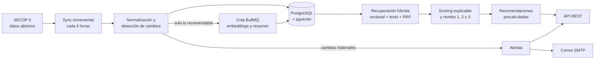
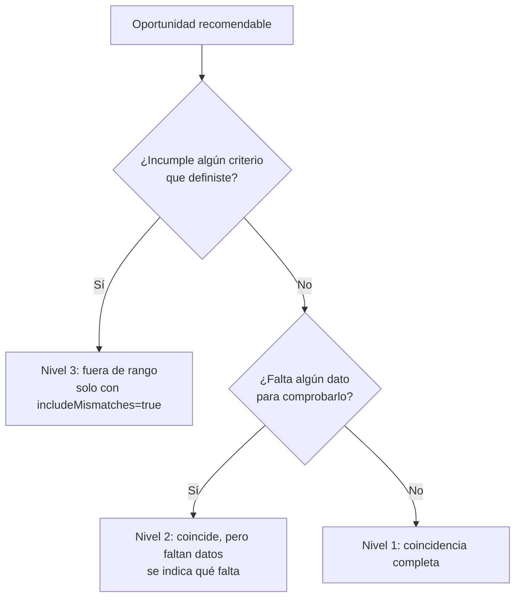
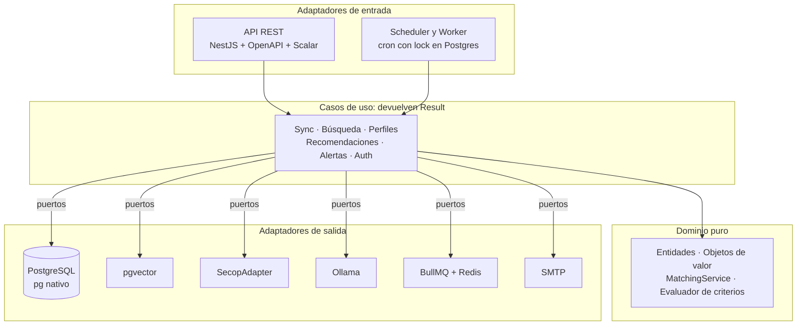

# Pliegos

**Inteligencia de contratación pública para Colombia.** Pliegos descubre las oportunidades de contratación estatal publicadas en SECOP II, las ordena según el perfil de cada contratista, explica por qué recomienda cada una y vigila los cambios que importan.

[](https://github.com/BramBit/Pliegos/actions/workflows/ci.yml)


> Este repositorio contiene el **backend** completo. El frontend está en diseño.

---

## ¿Qué es Pliegos?

Cada día se publican cientos de procesos en SECOP II. Un contratista que quiere participar tiene que revisarlos a mano, interpretar descripciones poco uniformes, descartar los que no puede ofertar y volver a mirar los que le interesan por si cambia un plazo. Es un trabajo repetitivo y fácil de hacer mal.

Pliegos no es solo un buscador. Es un analista que trabaja en segundo plano:

1. **Descubre.** Sincroniza los procesos de SECOP II de forma incremental y detecta qué es nuevo y qué cambió.
2. **Filtra.** Descarta lo que no se puede ofertar: contratación directa, régimen especial, procesos cerrados, adjudicados o cancelados.
3. **Prioriza con explicación.** Cada recomendación trae un puntaje y los factores que lo componen. Nada es una caja negra.
4. **Es honesto con los datos incompletos.** SECOP publica información faltante o inconsistente. Pliegos no la esconde ni la descarta: muestra esos procesos en un nivel aparte, indicando qué no se pudo comprobar.
5. **Vigila.** Si un proceso que sigues cambia su fecha de cierre, su monto o su estado, o se acerca a su plazo, te avisa en la bandeja y por correo.

---

## Cómo funciona



**Ingesta.** El `SecopAdapter` consulta el conjunto de datos abiertos «SECOP II – Procesos de Contratación» (`p6dx-8zbt`, plataforma Socrata). Pagina, reintenta ante fallos transitorios y usa la fecha de última publicación como marca de agua con un día de solape, de modo que las adendas de procesos antiguos también llegan. Una segunda pasada trae los procesos competitivos que siguen abiertos.

**Normalización.** Todo el mapeo del formato crudo vive en el adaptador. Los marcadores vacíos («No Definido», «UNSPECIFIED»), los códigos UNSPSC con prefijo y los nombres de departamento se llevan a una forma canónica, y el valor original se conserva en columnas aparte. Un monto ausente se registra como desconocido, no como cero.

**Análisis.** Solo las oportunidades recomendables se convierten en vectores de 768 dimensiones (`nomic-embed-text`, vía Ollama). El análisis es idempotente: un hash del contenido evita recalcular cuando solo cambió la fecha de cierre. Los resúmenes con LLM se generan bajo demanda, tratando el texto de SECOP como dato y no como instrucciones, con un texto de respaldo si el modelo falla.

**Recuperación.** Una búsqueda híbrida combina similitud coseno en pgvector con búsqueda de texto completo en español, fusionadas con Reciprocal Rank Fusion. Si una de las dos vías falla, se responde con la otra y se marca `degraded`.

**Recomendación.** Un job recalcula las recomendaciones de cada perfil cuando cambia el perfil o el sync trae novedades. La lectura (`GET`) nunca calcula ni escribe.

---

## Filosofía de diseño

- **Explicable antes que ingenioso.** Si el sistema no puede decir por qué recomienda algo, no lo recomienda.
- **Los datos faltantes no son un error del usuario.** Un criterio que no se puede comprobar no excluye un proceso: lo mueve de nivel y lo etiqueta.
- **Lo que no se puede ofertar no se muestra.** La exclusión es por razones objetivas y no depende de los filtros del usuario.
- **IA local y costo cero.** Embeddings y resúmenes corren en Ollama. Sin claves de API, sin datos que salgan de tu máquina.
- **Medir la relevancia.** Hay un conjunto de oro etiquetado, métricas de ranking y un umbral que falla el build si la calidad retrocede.
- **Operable.** Cada ejecución de sync, análisis, refresco y alertas queda registrada; los modelos se miden; hay sondas de salud y cierre ordenado.
- **Sin ORM.** SQL explícito sobre el driver `pg`, para controlar las consultas vectoriales y de texto.

---

## Resultados por niveles

Nada es obligatorio. Con un texto o las palabras clave del perfil basta para definir el sector. Cada criterio adicional (monto, departamento, categoría, fechas de cierre) se evalúa en tres estados: **cumple**, **no cumple** o **sin dato**.



Los resultados se ordenan por nivel y luego por relevancia. Cada ítem incluye `matchTier`, `missingCriteria` (por ejemplo `["amount"]`) y `statusConfidence`, y cada página incluye `tierCounts`, para que el frontend pueda mostrar «12 coinciden, 40 con datos incompletos» y dejar que el usuario decida.

---

## Recomendaciones explicables

El puntaje combina cuatro factores, y **solo cuenta los que se pueden evaluar**:

| Factor | Peso relativo | Qué mide |
| --- | --- | --- |
| Similitud semántica | 0,35 | Coseno entre el perfil y la oportunidad, normalizado entre 0,40 y 0,75 |
| Categoría UNSPSC | 0,35 | Coincidencia jerárquica del código |
| Monto | 0,20 | 1 dentro del rango; decae linealmente a 0 al salir de él |
| Ubicación | 0,10 | Departamento canónico del perfil frente al de la entidad |

`score = Σ(peso × factor) / Σ(pesos disponibles)`. Si una oportunidad no declara categoría, ese factor no cuenta como cero: se excluye y los demás se reescalan. Las recomendaciones bajo `0,45` no se muestran.

```json
{
  "score": 0.78,
  "matchTier": 2,
  "missingCriteria": ["amount"],
  "explanation": {
    "summary": "Oportunidad recomendada por: Coincidencia semántica con tu perfil (85%); La ubicación coincide con tus departamentos de interés.",
    "matchedFactors": [
      { "factor": "semanticSimilarity", "score": 0.85, "description": "Coincidencia semántica con tu perfil (85%)" },
      { "factor": "locationMatch", "score": 1, "description": "La ubicación coincide con tus departamentos de interés" }
    ],
    "unavailableFactors": ["La oportunidad no declara categoría UNSPSC"]
  }
}
```

El usuario puede marcar cada recomendación como **Participar** (la añade a su vigilancia) o **Descartar**, y puede deshacerlo.

---

## Arquitectura

Arquitectura hexagonal (puertos y adaptadores). El dominio no depende de ningún framework; las reglas de dependencia se verifican automáticamente en CI.



Estructura de `src/modules`:

| Módulo | Responsabilidad |
| --- | --- |
| `opportunity` | Ingesta, normalización, búsqueda, análisis y detalle de procesos |
| `profile` | Perfiles de contratista: capacidades, categorías, rango de monto, departamentos |
| `recommendation` | Scoring, niveles, retroalimentación y vigilancia |
| `alert` | Alertas por cambios y por plazos, bandeja y envío de correo |
| `auth` | Usuarios, JWT con rotación de refresh, roles |
| `admin` | Rutas operativas: sync, alertas, refresco, métricas y ejecuciones |
| `health` | Sondas de vida y disponibilidad |
| `scheduler` | Tareas programadas del proceso worker |
| `shared` | Configuración, lock en Postgres, medición de IA, utilidades de prueba |

**Decisiones notables:** errores de negocio como valores (`Result<T, E>`), `throw` solo para fallos de infraestructura; migraciones SQL versionadas e idempotentes; consultas por lote sin N+1; cron protegido con lock advisory para que no se duplique con varias instancias; proceso API y proceso worker separados.

---

## Seguridad

- Autenticación con JWT de acceso (15 minutos) y refresco con rotación (7 días). Contraseñas con `scrypt`.
- Cada recurso pertenece a un usuario: acceder al recurso de otro devuelve `404`, sin filtrar su existencia.
- Rutas `/admin/*` solo para rol `admin`.
- Validación de entrada con Zod en cuerpo, parámetros y consultas.
- Límite global de 120 solicitudes por minuto por IP, 10 por minuto en `/auth/*` y bloqueo de login tras 5 intentos fallidos en 15 minutos.
- `helmet`, CORS restringido por lista (`CORS_ORIGINS`) y rechazo del secreto JWT de plantilla en producción.

---

## Calidad y verificación

- Más de 500 pruebas automatizadas (unitarias, de integración con Postgres real y de extremo a extremo de la API).
- TypeScript en modo estricto, ESLint, Prettier y reglas de arquitectura con `dependency-cruiser`.
- **Evaluación de relevancia.** `eval/` contiene perfiles de prueba, candidatos obtenidos con búsqueda de texto y vectorial, etiquetas de relevancia (criterios en [`eval/LABELING.md`](eval/LABELING.md)) y umbrales de `precision@10` y `nDCG@10`. `pnpm eval:run` falla si la calidad baja de esos umbrales.
- **Puerta de calidad.** `pnpm verify` ejecuta compilación, lint, pruebas, arquitectura, migraciones sobre una base vacía, OpenAPI al día, cobertura de datos reales y evaluación de relevancia, y responde con una línea por cada comprobación.
- La calidad de los datos de la fuente se reporta como advertencia con un piso de seguridad, porque no depende del proyecto.

---

## Puesta en marcha

### Requisitos

- Docker y Docker Compose.
- [Ollama](https://ollama.com/) corriendo en tu máquina con los modelos:

```bash
ollama pull nomic-embed-text
ollama pull llama3.1
```

### Con Docker (recomendado)

```bash
cp .env.example .env
docker compose up -d --build
```

Esto levanta PostgreSQL con pgvector (puerto `5433`), Redis, Mailpit (SMTP `1025`, bandeja web `8025`), aplica las migraciones y arranca la API (`3000`) y el worker.

| URL | Qué es |
| --- | --- |
| http://localhost:3000/reference | Documentación interactiva (Scalar) |
| http://localhost:3000/api-json | Especificación OpenAPI |
| http://localhost:3000/health/ready | Disponibilidad de Postgres, Redis y Ollama |
| http://localhost:8025 | Correos de desarrollo (Mailpit) |

### Desarrollo local

Node.js 24 y pnpm:

```bash
pnpm install
docker compose up -d postgres redis mailpit
pnpm db:migrate
pnpm start:dev          # API y worker en un solo proceso
```

Para separar procesos: `pnpm build`, luego `pnpm start:api` y `pnpm start:worker`.

### Primer recorrido por la API

```bash
# 1. Registro y sesión
curl -X POST localhost:3000/auth/register -H 'content-type: application/json' \
  -d '{"email":"yo@ejemplo.co","password":"una-clave-larga-123"}'
TOKEN=$(curl -s -X POST localhost:3000/auth/login -H 'content-type: application/json' \
  -d '{"email":"yo@ejemplo.co","password":"una-clave-larga-123"}' | jq -r .accessToken)

# 2. Perfil
curl -X POST localhost:3000/profiles -H "authorization: Bearer $TOKEN" -H 'content-type: application/json' \
  -d '{"name":"Mi perfil","contactEmail":"yo@ejemplo.co","sector":"Tecnologías de la información",
       "capabilities":[{"name":"Desarrollo de software","yearsOfExperience":5}],
       "preferences":{"categoryCodes":[],"keywords":["software","ciberseguridad"],
                      "departments":["Antioquia"],"amountRange":{"min":50000000,"max":500000000}}}'

# 3. Búsqueda con niveles
curl "localhost:3000/opportunities?q=software&department=Antioquia&minAmount=50000000" \
  -H "authorization: Bearer $TOKEN"
```

Para cargar datos hay que ejecutar un sync como administrador: `pnpm admin:create <correo> <clave>`, iniciar sesión con ese usuario y llamar a `POST /admin/sync`. La guía operativa completa está en [`docs/runbook.md`](docs/runbook.md).

---

## API

La especificación completa está en [`docs/openapi.json`](docs/openapi.json). Resumen por área:

| Área | Rutas principales |
| --- | --- |
| Sesión | `POST /auth/register` · `/auth/login` · `/auth/refresh` · `/auth/logout` · `GET /auth/me` |
| Oportunidades | `GET /opportunities` (búsqueda, filtros, niveles, paginación) · `GET /opportunities/{id}` |
| Perfiles | `POST/GET /profiles` · `GET/PUT/DELETE /profiles/{id}` · `GET /profiles/{id}/summary` |
| Recomendaciones | `GET /profiles/{id}/recommendations` · `POST/DELETE /recommendations/{id}/feedback` |
| Vigilancia | `GET /profiles/{id}/watches` · `POST/DELETE /profiles/{id}/watches/{opportunityId}` |
| Alertas | `GET /profiles/{id}/alerts` · `POST /alerts/{id}/read` · `POST /profiles/{id}/alerts/read-all` |
| Administración | `POST /admin/sync` · `/admin/alerts/run` · `/admin/recommendations/refresh` · `GET /admin/jobs/{id}` · `/admin/metrics` · `/admin/pipeline` |
| Operación | `GET /health/live` · `/health/ready` |

Salvo el registro, el login, el refresco y cierre de sesión, las sondas `/health/*` y la documentación, todas las rutas requieren `Authorization: Bearer <token>`.

---

## Configuración

Todas las variables se validan con Zod al arrancar y el proceso falla con un mensaje claro si alguna es inválida. La lista completa, con comentarios, está en [`.env.example`](.env.example). Las más relevantes:

| Variable | Descripción |
| --- | --- |
| `DATABASE_URL` | Conexión a PostgreSQL (sin valor por defecto) |
| `REDIS_HOST`, `REDIS_PORT` | Redis para las colas |
| `OLLAMA_BASE_URL`, `OLLAMA_EMBED_MODEL`, `OLLAMA_CHAT_MODEL` | IA local |
| `JWT_SECRET` | Mínimo 32 caracteres; la plantilla se rechaza en producción |
| `ROLE` | `api`, `worker` o `all` |
| `SYNC_OPPORTUNITIES_CRON` | Frecuencia del sync (por defecto cada 4 horas) |
| `SECOP_APP_TOKEN` | Token opcional de Socrata para aumentar el límite de consultas |
| `MIN_RECOMMENDATION_SCORE` | Puntaje mínimo para recomendar (por defecto 0,45) |
| `CORS_ORIGINS` | Orígenes permitidos, separados por comas |
| `SMTP_*` | Servidor de correo para las alertas |

---

## Scripts útiles

| Script | Para qué sirve |
| --- | --- |
| `pnpm test` | Suite completa (requiere Postgres y Redis) |
| `pnpm verify` | Puerta de calidad del backend |
| `pnpm db:migrate` | Aplica las migraciones pendientes |
| `pnpm reindex` | Genera embeddings de las oportunidades recomendables pendientes (reanudable) |
| `pnpm audit:data` | Informe de calidad y cobertura de los datos |
| `pnpm eval:export` · `pnpm eval:run` | Genera candidatos y mide la relevancia contra las etiquetas |
| `pnpm backfill:departments` · `pnpm resync:unknown` | Mantenimiento de datos |
| `pnpm check:arch` | Reglas de la arquitectura hexagonal |
| `pnpm admin:create` | Crea un usuario administrador |

---

## Limitaciones conocidas y hoja de ruta

**Limitaciones**

- **No lee los documentos del proceso.** Pliegos trabaja con los metadatos y la descripción que SECOP publica como datos abiertos. No analiza los pliegos de condiciones ni sus anexos, así que no extrae requisitos habilitantes.
- **La calidad depende de la fuente.** Montos, categorías o departamentos ausentes son frecuentes. Por eso existen los niveles.
- **Embeddings en español.** `nomic-embed-text` está pensado sobre todo para inglés. Está pendiente comparar un modelo multilingüe contra el conjunto de oro.
- **La evaluación es acotada.** Tres perfiles de prueba etiquetados por una sola persona: sirve para detectar retrocesos, no como medida absoluta.
- **IA local.** La velocidad de indexación y resumen depende del hardware donde corra Ollama.
- **Límite de login en memoria.** Con varias instancias de la API, el bloqueo por intentos fallidos sería por instancia.
- **Una sola fuente.** SECOP II. La ingesta está detrás de un puerto, por lo que añadir otra fuente no toca el dominio.

**Hoja de ruta**

- Frontend.
- Análisis de los documentos de cada proceso, sujeto a revisar el acceso técnico y las condiciones de uso.
- Selector de categorías UNSPSC con nombres en español.
- Comparación de modelos de embeddings multilingües.
- Estado de límites y sesiones compartido entre instancias.

---

## Fuente de datos y uso responsable

Los datos provienen del portal de datos abiertos del Estado colombiano (datos.gov.co), conjunto «SECOP II – Procesos de Contratación». Pliegos es un proyecto independiente y no tiene relación con Colombia Compra Eficiente ni con las entidades contratantes. Las recomendaciones son una ayuda para priorizar: antes de ofertar, consulta siempre el proceso original en SECOP II.

## Licencia

Todos los derechos reservados. El código se publica con fines de consulta y evaluación.
